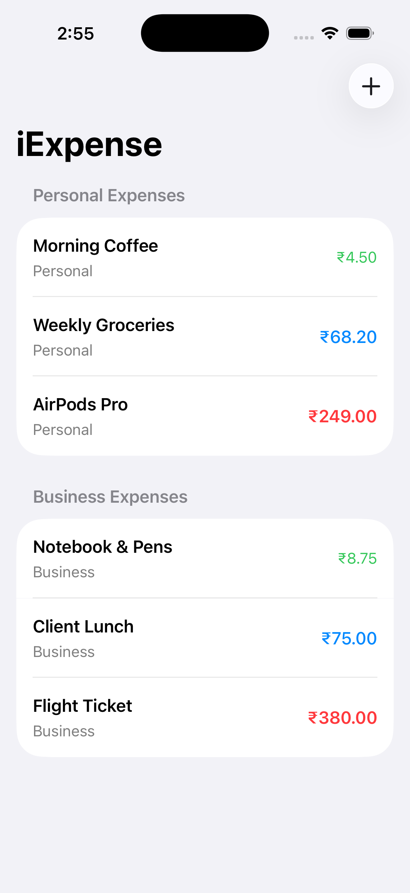
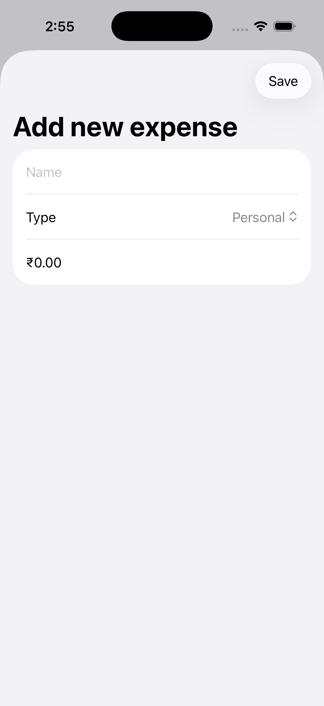

# iExpense 💳

An intuitive personal and business expense tracking application for iOS built with **SwiftUI**, developed as part of Paul Hudson's *100 Days of SwiftUI* (Project 7 & Wrap-Up Challenges).

iExpense allows users to log everyday expenses, categorize them into personal and business spending, track costs with dynamic visual styling, and persist data seamlessly across launches using `UserDefaults` and `Codable`.

---

## 📱 Preview

<p align="center">
  
  &nbsp;&nbsp;&nbsp;&nbsp;
  
</p>

---

## ✨ Features

- **Categorized Sections**: Distinct sections separating **Personal** and **Business** expenses.
- **Dynamic Value-Based Styling**: Expense amounts adapt visually to highlight expenditure levels:
  - **Under ₹10 / $10**: Subtle subheadline style in green.
  - **Under ₹100 / $100**: Medium weight style in blue.
  - **₹100 / $100 and above**: Prominent bold style in red.
- **Locale-Aware Currency**: Formats currency dynamically according to the user's device locale (`Locale.current.currency`).
- **Data Persistence**: Automatic encoding and decoding of expenses to `UserDefaults` via `Codable` and JSON.
- **Safe Swipe-to-Delete**: Independent swipe-to-delete per section, reliably mapping deletions back to the single master data source.
- **Modal Add Expense Sheet**: Clean input form featuring item name, category picker, currency input, and keyboard toolbar handling.

---

## 🛠 Tech Stack & Concepts

- **Language:** Swift 5.9+
- **Framework:** SwiftUI
- **State Management:** Modern `@Observable` macro (iOS 17+)
- **Persistence:** `UserDefaults` with `Codable` (`JSONEncoder` / `JSONDecoder`)
- **Key Concepts:**
  - `@Observable` class for multi-view shared reactive state
  - `@State` property wrappers for local view state
  - Sheet presentation with `@Environment(\.dismiss)`
  - Index-safe `onDelete` handling on filtered collections
  - Conditional view styling via `@ViewBuilder` and helper functions
  - Form validation and decimal input formatting

---

## 🚀 Getting Started

### Prerequisites

- macOS Sonoma or later
- Xcode 15.0 or later
- iOS 17.0+ Simulator or physical device

### Installation

1. **Clone the repository:**
   ```bash
   git clone https://github.com/selva7378/iExpense.git
   cd iExpense
   ```

2. **Open the project in Xcode:**
   ```bash
   open iExpense.xcodeproj
   ```

3. **Run the App:**
   - Select your target simulator or connected iOS device in Xcode.
   - Press `Cmd + R` to build and run.

---

## 📂 Project Structure

```text
iExpense/
├── iExpense.xcodeproj         # Xcode project configuration
├── iExpense/                  # Swift source files
│   ├── iExpenseApp.swift      # Application entry point (@main)
│   ├── ContentView.swift      # Primary view with categorized lists & styling
│   ├── AddView.swift          # Modal sheet form to add new expenses
│   ├── Expenses.swift         # @Observable data store with UserDefaults persistence
│   ├── ExpenseItem.swift      # Identifiable & Codable expense model
│   └── Assets.xcassets        # App icons and color catalog
├── screenshots/               # App screenshots for documentation
│   ├── expenses_list.png      # Main expense list preview
│   └── add_expense.png        # Add expense sheet preview
└── README.md                  # Project documentation
```

---

## 👤 Author

- **Selva Ganesh** - [GitHub](https://github.com/selva7378)
